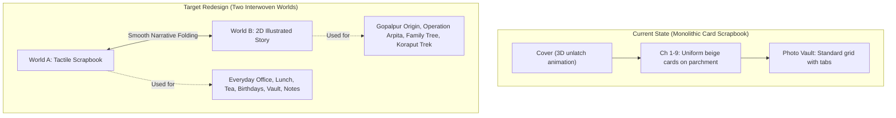
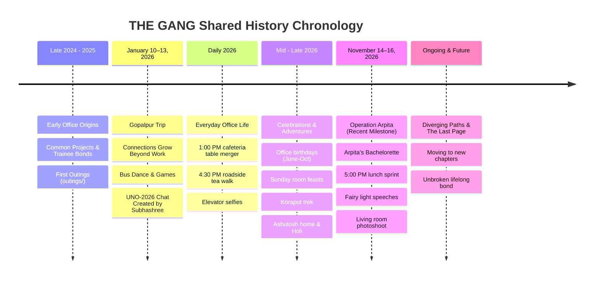
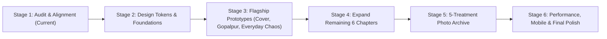

# REDESIGN_AUDIT.md — THE GANG Redesign & Creative Audit
**Date**: November 19, 2026  
**Auditor**: Senior Creative Director & Lead Frontend Architect  
**Project**: THE GANG — An Illustrated, Cinematic, Interactive Digital Memory Book  
**Live Site Assessed**: `the-gang-six.vercel.app` vs. Local Codebase  

---

## Executive Summary
Antigravity previously assembled a functional content prototype with all 9 chapters, 14 characters, and the photo vault. However, the current build functions primarily as a **sequential presentation of card sections** rather than an **interactive, living memory book**.

This audit establishes the concrete discrepancies, reconciles the exact chronological timeline, catalogs all 155 photographic assets, diagnoses the animation architecture, and defines the roadmap to bring our **Two Complementary Visual Worlds** (Tactile Scrapbook + 2D Illustrated Story) to life.

> [!IMPORTANT]
> **Stage 1 Constraint Respected**: No destructive code changes or premature rewrites have been made. This audit is presented for your review and approval before proceeding to implementation.

---

## 1. Existing Architecture Assessment

### Technology Stack Overview
| Layer | Current Technology | Health Status | Assessment |
| :--- | :--- | :--- | :--- |
| **Framework** | Next.js 16.4.6 (App Router) | ✅ Modern | Excellent foundation for server-side generation, dynamic imports, and image routing. |
| **UI Library** | React 19.0.0 & React DOM 19 | ✅ Latest | Strict mode compliant, zero hydration warnings. |
| **Styling** | Tailwind CSS 3.4.17 | ✅ Configured | Warm palette (parchment `#F3EBDD`, ink `#262522`, terracotta `#C96E59`, mustard `#D9B76B`) well established. |
| **Motion** | GSAP 3.12.7 + ScrollTrigger | ⚠️ Underutilized | Currently active **only** in `SceneCover.tsx`. Chapters 1–9 have zero GSAP animation. |
| **Smooth Scroll**| Lenis 1.1.20 | ✅ Operational | Synchronized with GSAP RAF ticker in `SmoothScroll.tsx`. |
| **Micro-Motion** | Framer Motion 12.4.7 | ⚠️ Underutilized | Installed in `package.json` but scarcely imported. |
| **Icons** | Lucide React 0.475.0 | ✅ Active | Clean SVG iconography for props and UI buttons. |

### Component Decomposition & Architectural Gaps
```
src/
├── app/
│   ├── layout.tsx         # Font loading (Fraunces, Caveat, DM Sans) + Lenis Provider
│   ├── page.tsx           # Flat list of 10 scene components (Needs ChapterRenderer abstraction)
│   └── globals.css        # Palette tokens, CSS keyframes, reduced-motion rules
├── components/
│   ├── characters/        # CharacterAvatar, CharacterCard, CharacterDoodle
│   ├── gallery/           # MemoryGallery (Photo Vault with isolated lightbox)
│   ├── scenes/            # 10 scene files (Cover + Ch01 to Ch09)
│   ├── scrapbook/         # Polaroid, WashiTape, StampBadge, HandwrittenNote, TornPaperEdge
│   └── shell/             # Header, ChapterNav, SmoothScroll
├── data/
│   ├── chapters.ts        # Chapter metadata and narratives
│   ├── characters.ts      # 14 character bios, props, relationships
│   └── photos.ts          # 141 indexed album photos (Generated)
└── types/
    ├── chapter.ts
    ├── character.ts
    └── memory.ts
```

### Architectural Deficiencies Identified:
1. **No Central Media Manifest (`media.ts`)**: Image paths in story scenes (`SceneChapter04_Everyday.tsx`, etc.) are hardcoded string literals (e.g. `imageSrc="/lunch/IMG_20260220_132922747.jpg"`). They are detached from `src/data/photos.ts`.
2. **Siloed Lightbox**: The lightbox exists strictly inside `MemoryGallery.tsx`. Clicking any Polaroid in Chapters 3, 4, 6, 7, or 8 does nothing.
3. **Missing Illustrated Primitives**: We have scrapbook primitives (`Polaroid`, `WashiTape`), but lack 2D illustration primitives (`CharacterSprite`, `ParallaxLayer`, `AnimatedDoodle`, `DottedRouteMap`, `ClockSprint`).
4. **Rigid Page Layout**: `page.tsx` renders all 10 scenes sequentially without lazy-loading heavy chapter assets.

---

## 2. Visual and UX Weaknesses — The "Two Worlds" Void

The original vision demands two distinct, harmonized visual systems:
- **World A: The Tactile Memory Book** (Polaroids, torn paper, washi tape, contact sheets, sticky notes, handwriting).
- **World B: The 2D Illustrated Story** (Hand-drawn character silhouettes, parallax environments, animated doodles, living resort/mountain scenes).

### Current Reality vs. Target State:


### Key Visual Flaws:
1. **Lack of Handcrafted 2D Environment**: Gopalpur, Operation Arpita, and Koraput currently look like ordinary text cards with a single Polaroid beside them. There are no ocean waves, no pool splashing, no misty mountain layers, no animated clock accelerating towards 5:00 PM.
2. **Monotonous Card Grids in Everyday Chaos**: Chapter 04 presents Lunch, Tea Breaks, and Elevator traditions in uniform cards. It needs dynamic tactile pockets:
   - A sprawling cafeteria table collage with passed tiffins.
   - A cutting chai glass stamp and roadside tea stall sketches.
   - An illustrated elevator frame cramming all 14 members together.
3. **Static Relationships**: The Family Tree in Chapter 05 displays nodes but lacks progressive SVG thread drawing, character reaction animations on hover, or click-to-reveal lore memories.

---

## 3. Content and Chronology Reconciliation

### The Critical Chronological Shift
In earlier iterations, the January 2026 Gopalpur Retreat and the November 2026 Bachelorette were conflated. The actual timeline is verified as follows:



### Chronology Audit Breakdown:
1. **Chapter 01: Before the Chaos** (2024–Early 2026) — Small quiet circle at Hyscaler office.
2. **Chapter 02: The Great Expansion** (Spring 2026) — 14 distinct personalities collide through projects and mentorship.
3. **Chapter 03: Gopalpur — When Separate Connections Came Together** (January 10–13, 2026)
   - *Verified Context*: Before the trip, the members already knew one another through common projects, different project teams, trainee relationships, and everyday office conversations. However, they weren't yet a particularly close-knit group.
   - *The Experience*: The connection started becoming more natural even before the bus departed. People gathered outside, talked, and took photographs. During the trip, everyone gradually became comfortable together through games, shared meals, dancing at the evening party, late-night games and conversations, and a morning visit to the beach.
   - *After the Trip*: Subhashree created an occasion-specific WhatsApp group called **UNO-2026**, where everyone shared photographs and bus-dancing videos recorded before reaching Gopalpur.
   - *Key Factual Clarification*: Gopalpur was not the formation of a formally named or permanent group. It was an occasion that helped people who already knew one another through work build connections beyond work. THE GANG is the name of this digital memory-book project, not the official name of one single WhatsApp group (members share several occasion-specific groups with overlapping membership).
4. **Chapter 04: The Everyday Office Life** (Throughout 2026)
   - 1:00 PM Cafeteria Lunch (table mergers, Jayashree's tiffin inspections).
   - 4:30 PM Outside Tea Breaks (evening walk to roadside tea stall, cutting chai).
   - The Elevator Gatherings (daily 14-person elevator crams).
5. **Chapter 05: Outings & Celebrations** (Throughout 2026)
   - Group Outings (`public/outings/`, 55 photos).
   - Birthday Celebrations (`public/bday celebrations/`, June–October 2026, 12 photos).
   - Sunday Room Feasts (Paresh cooking curry, Dushmanta movie debates).
6. **Chapter 06: The Gang Family Tree (Evergreen Relationship Constellation)**
   - *Important Distinction*: This is an **evergreen relationship section**, not a chronological event. The navigation will clearly distinguish it as an interactive constellation map of the group's dynamic:
   - Strictly "The 3 Musketeers" (Astha, Subhashree, Arpita).
   - "The Bitter Half" (Shyamalendu & Asutosh).
   - "Arpita's Adopted Sons" (Dushmanta & Niyaz).
   - "The Invisible Man" (Tapan / Luffy).
   - "The Code Machine" (Soumya), "The Gentleman Writer" (Paresh), "The Morning Inspector" (Jayashree), etc.
7. **Chapter 07: The Wild Adventures** (2026)
   - Koraput Mountain Trek (misty trails, Tapan quietly massaging Arpita's leg).
   - Ashutosh's Home (family feasts & vibrant Holi colors).
8. **Chapter 08: Operation Arpita — The 5 PM Lunch & Farewell Milestone** (November 14–16, 2026)
   - Verified via `public/bachelorette/` filenames (`IMG_20261114_...` to `IMG-20261116_...`).
   - The **most recent major milestone**. Secret preparations, pool madness, lunch literally eaten at 5:00 PM, evening lawn toasts under fairy lights, hotel treasure hunt, and living room photoshoot.
   - Celebrated as our latest milestone—not an ending, but a celebration of our Penguin Mom as people prepare for diverging paths.
9. **Chapter 09: Diverging Paths & The Last Page** (Ongoing / Forever)
   - "A way of everyone going in different ways": not a sad goodbye or closed book, but celebrating how ordinary days became enduring memories.
   - The last page remains open: *"Friendship loading... to be continued."*
   - Soumya's poem for Tapan, Arpita's leg massage quote, master 14-person illustration spread.

### Character Dimension Audit:
- **Tapan / Luffy**: Previously flattened into a pure zen listener. Must be updated to reflect his complete personality: calm, quiet listener and dependable caregiver during crises, *balanced with* his teasing, dry humor, rage-baiting, and stubborn appetite.
- **Asutosh vs. Ashutosh**: Strictly segregated (Vegetable encyclopedia vs. Gracious daydream host).
- **The 3 Musketeers**: Verified as Astha, Subhashree, and Arpita.

---

## 4. Asset Inventory and Missing-Photo Report

### Verified Disk Asset Counts
| Folder Path | Physical File Count | Date Range Extracted | Purpose / Category |
| :--- | :--- | :--- | :--- |
| `public/avatars/` | 14 files | N/A | 14 character portrait files (1 per member) |
| `public/gopalpur/` | 19 files | 2026-01-10 to 2026-01-13 | Origin retreat where group bonded |
| `public/lunch/` | 20 files | 2025-01-04 to 2026-10-16 | Daily 1:00 PM cafeteria table merger |
| `public/tea breaks/` | 11 files | 2026-01-09 to 2026-11-16 | Daily 4:30 PM outside roadside tea walks |
| `public/elevator photos/` | 5 files | 2026-02-10 to 2026-11-07 | Daily elevator cram selfies |
| `public/bday celebrations/` | 12 files | 2026-06-11 to 2026-10-09 | Office birthday cake cuttings & parties |
| `public/outings/` | 55 files | 2024-11-01 to 2026-11-02 | Road trips, weekend hangouts, room feasts |
| `public/bachelorette/` | 19 files | 2026-11-14 to 2026-11-16 | Arpita's Bachelorette (Recent milestone, 5 PM lunch) |
| **TOTALS** | **155 files** | **2024 to Nov 2026** | **141 album keepsakes + 14 portraits** |

### Missing-Photo Report:
- **Zero missing files on disk**. All 155 photographic assets are present in the filesystem.
- **Previous Discrepancy Resolved**: The previous live site displayed 122 photos because `public/gopalpur/` had not yet been copied into `public/`. Now `public/gopalpur/` (19 photos) is fully recognized, bringing the total album photos to exactly **141 photos** (155 including the 14 avatars).
- **Room Feasts Category**: Photographs of room cooking and floor dining exist within `public/outings/` and `public/lunch/`. In the unified manifest, we will tag these specific photos with `category: "room-feasts"` without duplicating physical files.

---

## 5. Animation and Performance Audit

### Current Motion Implementation
- **Cover Scene (`SceneCover.tsx`)**: Successfully pins and animates 3D scrapbook cover rotation, strap unbuckling, and Polaroid scatter using GSAP timeline.
- **Chapters 01–09**: Contain **zero GSAP ScrollTriggers**. They behave as static vertical HTML blocks.
- **Smooth Scrolling (`SmoothScroll.tsx`)**: Lenis runs smoothly and binds to `ScrollTrigger.update`, but has nothing to trigger in the body of the story.

### Performance & Mobile Bottlenecks:
1. **Uncompressed High-Res Imagery**: Several files in `gopalpur/` and `bachelorette/` exceed 4MB–10MB each (e.g. `IMG_20261114_192152888.jpg` is 8.1MB, `IMG_20261115_091828014.jpg` is 10.7MB). If rendered concurrently on mobile, this will cause memory pressure and jank.
2. **Missing Thumbnail / Responsive `sizes` Pipeline**: Images currently lack tailored responsive `sizes` attribute on Next.js `<Image>`, forcing mobile viewports to download full desktop resolutions.
3. **No Dynamic Scene Imports**: All 10 scene components are bundled together in `src/app/page.tsx`, inflating initial JavaScript execution time.

---

## 6. Proposed Reusable Component Architecture

To prevent hardcoded data and duplication, we will structure the codebase into clear layers:

```
src/
├── types/
│   └── media.ts              # Unified MemoryPhoto type (id, src, folder, category, date, layout, participants)
├── data/
│   ├── media.ts              # Central media manifest (All 141 photos with metadata)
│   ├── characters.ts         # 14 profiles with multi-faceted traits & inside jokes
│   └── chapters.ts           # 9 chapters with chronological milestones
├── components/
│   ├── scrapbook/            # World A Primitives: Polaroid, FilmStrip, ContactSheet, WashiTape, StampBadge, PaperClip
│   ├── illustrations/        # World B Primitives: CharacterSprite, ParallaxLayer, DottedRoute, ClockSprint, BeachScene
│   ├── shell/                # ChapterNav, SmoothScroll, GlobalLightboxProvider
│   └── scenes/               # Chapter Scenes 01 to 09 (Each self-contained with GSAP lifecycle cleanup)
```

---

## 7. Prioritised Redesign Roadmap



### Stage-by-Stage Plan:

- **Stage 1 (Current)**: Deliver `REDESIGN_AUDIT.md`, present findings, and obtain user approval.
- **Stage 2: Foundations & Central Manifest**
  - Implement `src/types/media.ts` and `src/data/media.ts` indexing all 141 photos with dates, categories, and layout treatments.
  - Implement global `LightboxContext` so every Polaroid across the website is clickable.
  - Update `src/data/characters.ts` to enrich Tapan's teasing side and polish all 14 character traits.
- **Stage 3: The Three Flagship Experiences**
  1. **Flagship 1: Opening Chapter (Dimensional Memory Book Unfold)**: Handcrafted paper opening, title handwriting SVG stroke reveal, first Polaroids sliding into place.
  2. **Flagship 2: Gopalpur Origin (World B — 2D Illustrated Environment)**: Illustrated ocean shoreline, rolling wave vectors, palm trees, sunrise glow, beach walk Polaroids from January 2026.
  3. **Flagship 3: The Everyday Chaos (World A — Tactile Scrapbook)**: Distinct non-uniform memory pockets:
     - 1:00 PM cafeteria table merger collage.
     - 4:30 PM roadside tea stall walk with cutting chai stamp.
     - Elevator gang frame cramming all 14 members.
     - Sunday room feast corner.
- **Stage 4: Expand Remaining Chapters**
  - Chapter 02: The Great Expansion (Staggered character entrances, stickers, banter).
  - Chapter 05: Outings & Birthday Celebrations (Cake cuttings, weekend road trips).
  - Chapter 06: The Gang Family Tree (Interactive SVG relationship constellation with click-to-reveal lore).
  - Chapter 07: The Wild Adventures (Koraput mountain parallax & Ashutosh's home Holi celebration).
  - Chapter 08: Operation Arpita — The 5 PM Lunch & Farewell Milestone (Recent November 2026 milestone, clock accelerating to 5 PM, pool splash, fairy lights, treasure hunt).
  - Chapter 09: Diverging Paths & The Last Page (Tribute letter, Soumya's poem, Arpita's quote, master group illustration, and the interactive "Last Page" turn).
- **Stage 5: The 5-Treatment Memory Archive**
  - Expand `MemoryGallery` into five distinct presentation treatments:
    1. *Polaroid Wall* (Everyday office & tea breaks).
    2. *Film-Strip Timeline* (Gopalpur & Bachelorette).
    3. *Large Editorial Feature* (Iconic group portraits).
    4. *Masonry Scrapbook* (Casual outings).
    5. *Contact Sheets* (Birthday parties & elevator batches).
- **Stage 6: Final Polish & Verification**
  - Responsive mobile testing, image optimization (AVIF/WebP, responsive `sizes`), keyboard accessibility, zero layout shifts, and clean production build.

---

> [!TIP]
> **Next Action**: Review this audit. Once you approve the proposed chronology, Two Worlds design direction, and roadmap, we will proceed directly to **Stage 2 & Stage 3 (Foundations and the Three Flagship Experiences)**!

